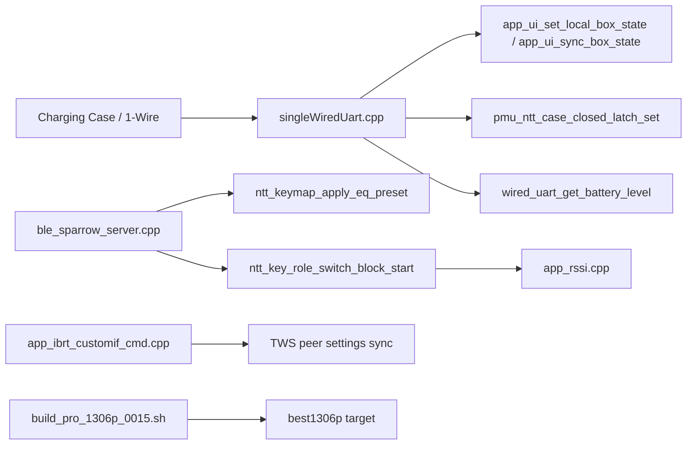
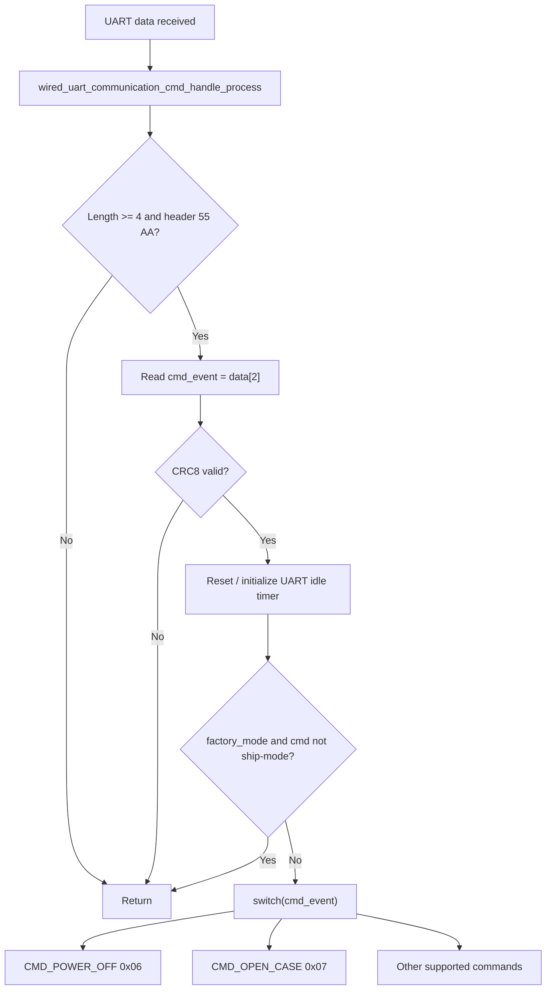
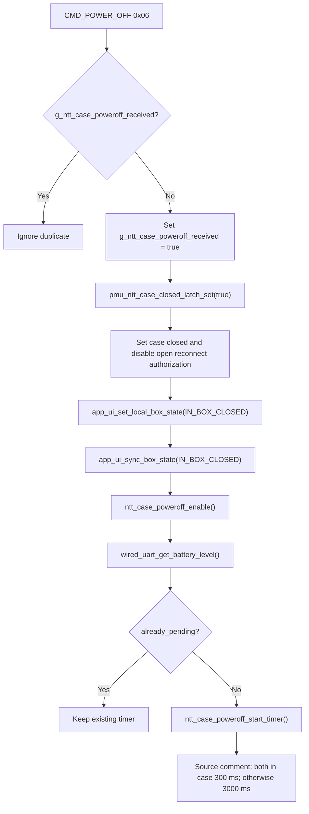
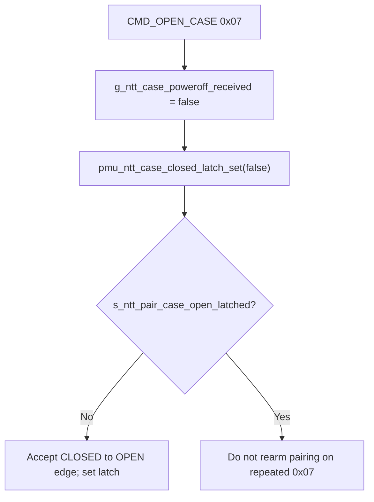
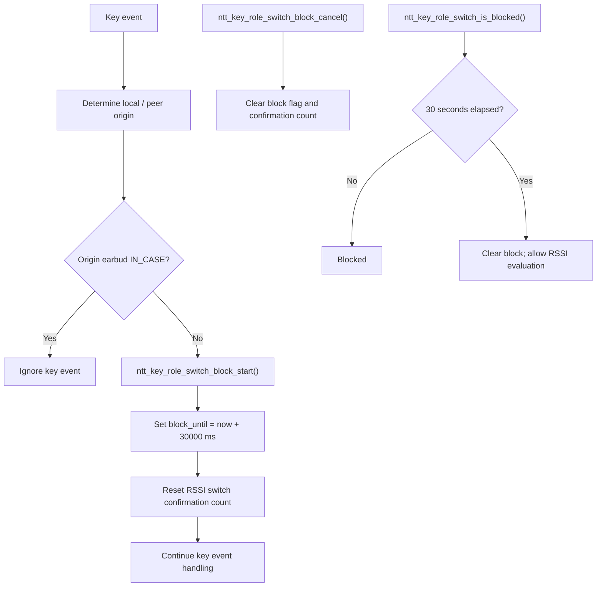
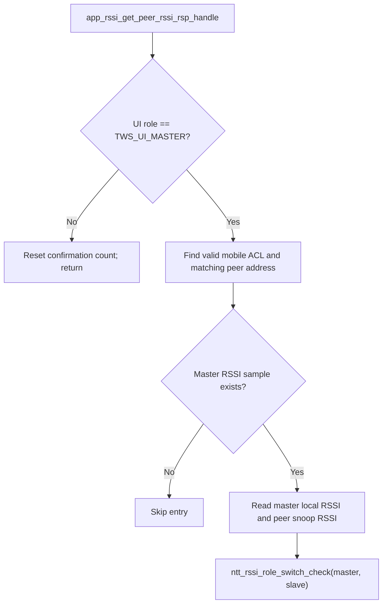
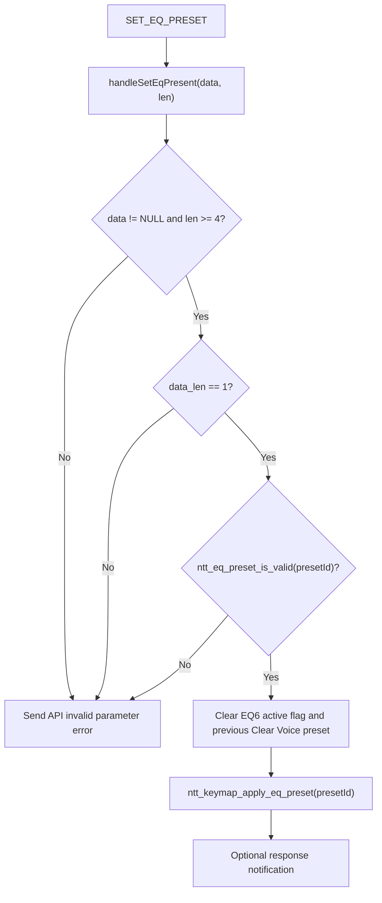
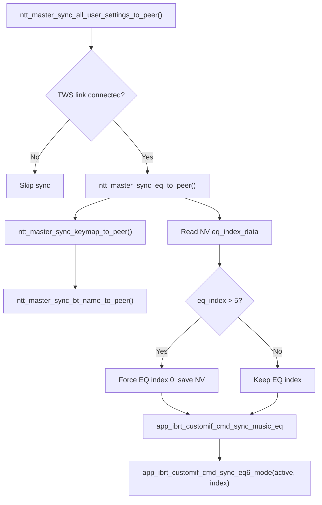
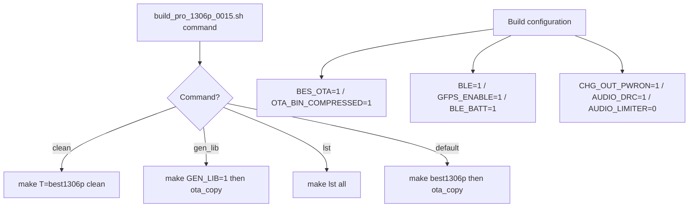

# NTT BES1306P Firmware - Source-Verified Flowcharts

**Repository:** `Derek-Vencer/common`  
**Commit:** `c326e79351cbe6ce49b9b6e7ddcca80a75a2b020`  
**Scope:** Verified source paths and functions below. These diagrams are **not** a complete SDK call graph. Solid arrows indicate source-observed control flow; high-level module arrows are marked as logical relationships.

## 01 - Verified module relationships

## 02 - 1-Wire receive and validation

**Source:** `services/aiwang_services/singleWiredUart.cpp`, lines 1598-1665, 2479.

## 03 - Case-close power-off (0x06)

**Source:** `services/aiwang_services/singleWiredUart.cpp`, lines 1831-1912. 300/3000 ms branches are documented in source comments; timer implementation must be inspected separately for exact runtime branching.

## 04 - Case open (0x07) latch release

**Source:** `services/aiwang_services/singleWiredUart.cpp`, lines 1913-1940.

## 05 - Key event and RSSI auto-role-switch block

**Sources:** `services/aiwang_services/ble_sparrow_server.cpp`, lines 3490-3525; `apps/btapp/app_rssi/app_rssi.cpp`, lines 120-146.

## 06 - Peer RSSI response and evaluation

**Source:** `apps/btapp/app_rssi/app_rssi.cpp`, lines 855-927.

## 07 - BLE EQ preset command

**Source:** `services/aiwang_services/ble_sparrow_server.cpp`, lines 2053-2092 and 2629-2640.

## 08 - Master sync of user settings

**Source:** `apps/earbuds/conn/app_ibrt_customif_cmd.cpp`, lines 372-429.

## 09 - Build configuration

**Source:** `tools/com_sdk/cust/build_pro_1306p_0015.sh`, lines 1-38; `config/best1306p/target.mk`, lines 1-35.

## Verification and limitations

The diagrams above were derived from **specific source files at the exact commit**, not from a generic TWS design. They are a **verified partial architecture**. Full boot sequence, A2DP pipeline, OTA state machine, exact timer implementation and complete cross-file call graph require additional source tracing and are intentionally not represented as confirmed execution paths.

**GitHub source reference:** `https://github.com/Derek-Vencer/common/tree/c326e79351cbe6ce49b9b6e7ddcca80a75a2b020`
